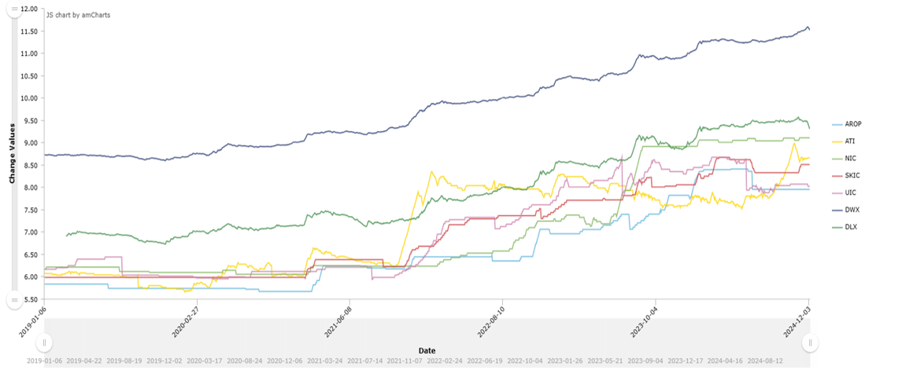
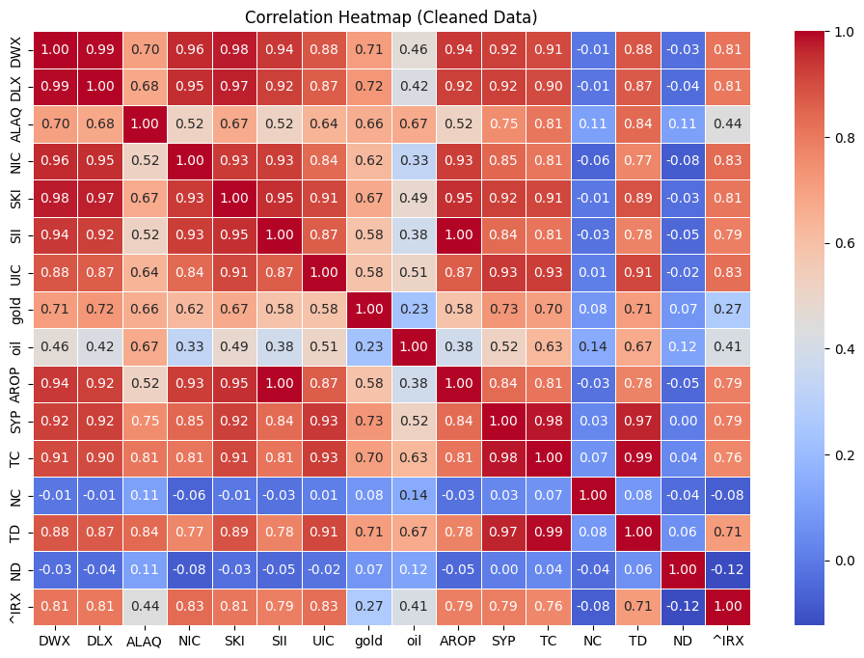
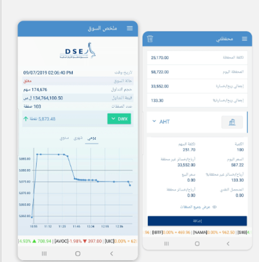
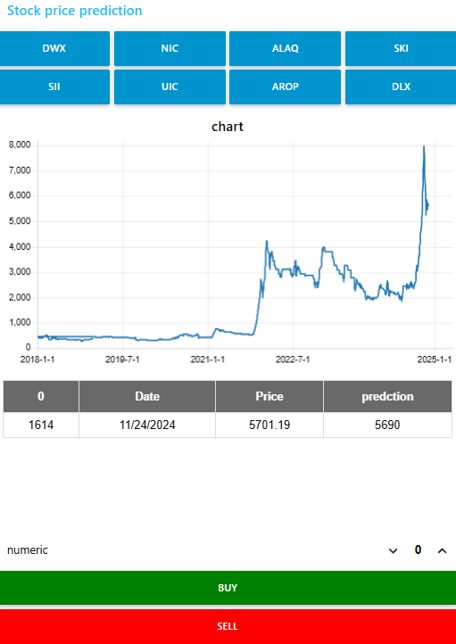
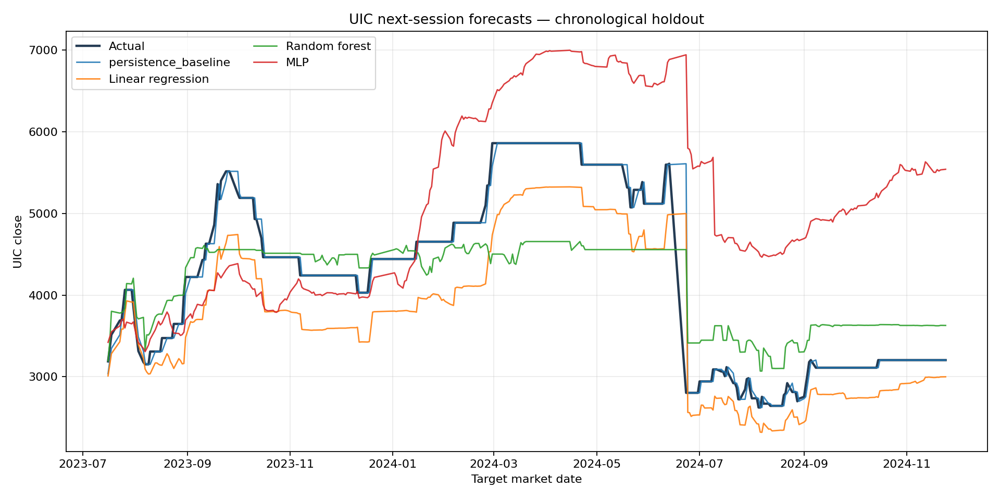

# Damascus Stock Market Forecasting

An applied machine-learning coursework project for exploring stock-price forecasting on the Damascus Securities Exchange (DSE). It brings together historical market data, exploratory analysis, regression models, and screenshots from an interactive investment-support prototype.

> **Research prototype:** This repository is for learning and research. Forecasts are not investment advice or a trading recommendation.

## Project overview

The original coursework, completed in 2024, studied whether DSE share prices could be forecast from other local market series and selected economic indicators. It discussed ordinary least squares, Random Forest, XGBoost, and a multilayer perceptron (MLP), and presented an interactive interface concept.

The PDF in `docs/coursework_report_ru.pdf` is the original coursework report. Its results table records the original experiments; the updated, time-ordered evaluation in this repository is reported separately below and in `results/chronological_holdout_metrics.csv`.

This repository provides a clean, reproducible Python analysis of the supplied consolidated dataset. It predicts the **UIC closing price at the next available market session**, compares several regressors with a persistence baseline, and keeps the original Russian coursework report and selected project visuals for context.



## What is included

- A consolidated DSE dataset covering **2 January 2018 through 24 November 2024**.
- A chronological evaluation pipeline that sorts market dates, resolves the repeated date, and avoids shuffled train/test splits.
- Linear Regression, Random Forest, and MLP models, plus an optional XGBoost model.
- A persistence baseline that predicts the next close using the current UIC close.
- A Jupyter walkthrough, saved holdout metrics and predictions, and generated charts.
- The original Russian coursework report and selected screenshots of the analysis and interface prototype.

## Selected project visuals

### Correlation analysis



### Interactive interface prototype





The screenshots document the interface concept presented with the coursework; the reproducible code in this repository focuses on data preparation and model evaluation.

## Dataset and sources

The bundled snapshot contains 1,614 source rows and 27 columns. The coursework report identifies the Damascus Securities Exchange as the source for local market series, Yahoo Finance for selected external market indicators, and the World Health Organization for COVID-19 indicators. The raw file is preserved under `data/raw/`; column names remain as supplied.

The source rows are not consistently ordered by date and contain one repeated date. The pipeline sorts observations in ascending date order and retains the last occurrence in the source file when dates repeat. Existing `pred*` columns are excluded from training so that stored output fields cannot leak into model inputs. See [`data/data_dictionary.md`](data/data_dictionary.md) for the fields and preprocessing details.

## Evaluation method

For each market date *t*, the features use values recorded for that session and the target is UIC's close at the next available market session. After chronological sorting, the first 80% of observations are used for training and the final 20% are held out. This is a single time-ordered holdout, not a rolling backtest.

The packaged results were generated from the included script. The persistence baseline outperformed the fitted regressors in this holdout, so the results do **not** support claiming that the tested machine-learning models provide useful predictive improvement.

| Model | MAE | RMSE | R² |
|---|---:|---:|---:|
| Persistence baseline | 48.20 | 179.23 | 0.9692 |
| Linear Regression | 507.21 | 558.44 | 0.7012 |
| Random Forest | 502.33 | 612.78 | 0.6403 |
| MLP | 1,158.96 | 1,396.63 | -0.8686 |



The optional XGBoost model is available when its extra dependency is installed. The table above records the included run, which was performed without that optional dependency.

The original model experiments used shuffled train/test splits and selected different target tickers in different model sections. Their reported scores are therefore not comparable out-of-sample results here. The included pipeline standardizes the prediction target to UIC and uses dates for a more appropriate holdout evaluation.

## Run the analysis

Python 3.10 or newer is recommended.

```bash
python -m venv .venv
```

Activate the environment, then install the required packages:

```bash
python -m pip install -r requirements.txt
```

Run the pipeline from the repository root:

```bash
python -m src.forecast
```

To include XGBoost in the comparison:

```bash
python -m pip install -r requirements-optional.txt
python -m src.forecast
```

The script writes metrics, holdout predictions, and figures to `results/`. To explore the steps interactively, install Jupyter and open `notebooks/forecasting_walkthrough.ipynb`.

## Repository structure

```text
.
├── assets/
│   ├── figures/                 # Project analysis figures
│   └── screenshots/             # Interface prototype screenshots
├── data/
│   ├── raw/dse_market_data.csv  # Consolidated source dataset
│   └── data_dictionary.md
├── docs/coursework_report_ru.pdf
├── notebooks/forecasting_walkthrough.ipynb
├── results/                     # Reproducible metrics, predictions, and charts
├── src/forecast.py              # Reproducible evaluation pipeline
├── requirements.txt
└── requirements-optional.txt
```

## License

No open-source license is granted with this publication. All rights remain with the author.
